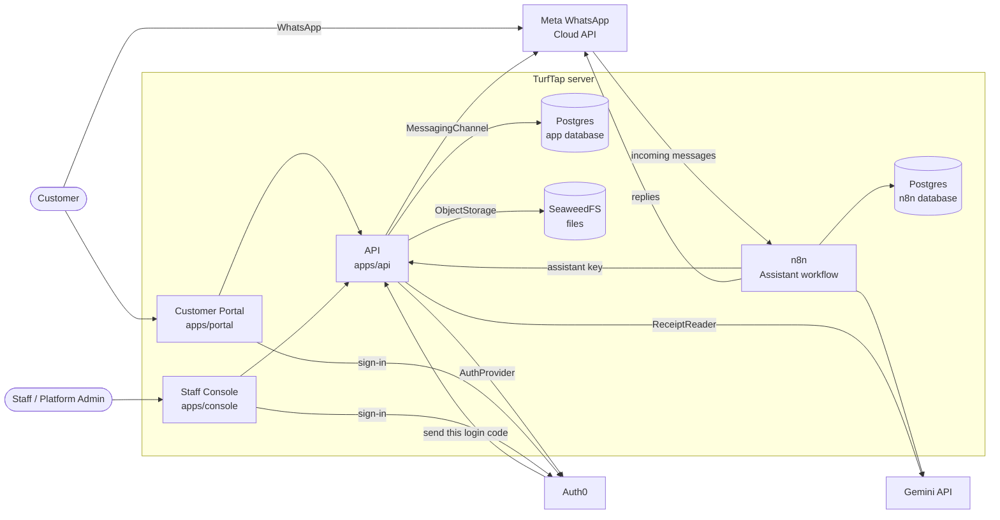

# Architecture overview

TurfTap is one backend app plus two websites, with n8n running the WhatsApp Assistant beside them. Big decisions and their reasons are in [docs/adr/](../adr/README.md). This page shows how the pieces fit.

## The pieces

| Piece | What it is | Code |
|---|---|---|
| API | Bun + Hono app. All business rules and all data. | `apps/api` |
| Customer Portal | React site at `<tenant>.turftap.lk`, phone-first | `apps/portal` |
| Staff Console | React site at `console.turftap.lk` for staff and Platform Admins | `apps/console` |
| Shared contract | Zod schemas for every request and reply, plus the generated OpenAPI file | `packages/contract` |
| Shared UI | Theme and components both sites use | `packages/ui` |
| Assistant | n8n workflow, exported to the repo | `n8n/workflows` |

## Inside the API

One folder per business area (a **module**) under `apps/api/src/modules/`:

| Module | Owns |
|---|---|
| `platform` | Tenants, users, WhatsApp numbers |
| `staff` | Staff and their roles |
| `venues` | Venues, opening hours, closed dates, resources, price rules, blocked times, photos |
| `customers` | Each tenant's customer records |
| `bookings` | Bookings, free slots, repeat series, reminders |
| `payments` | Payments, transfer receipts, receipt checks, refunds |
| `memberships` | Membership plans, memberships, check-ins |
| `notifications` | Every message the backend sends (through `MessagingChannel`) |
| `files` | Uploads and downloads (through `ObjectStorage`) |

A request flows **routes → service → repository**:

| Layer | Does | Never does |
|---|---|---|
| Routes | Declared once per resource with `defineResource()`. Checks input and permission, calls one service function. | Business rules, SQL |
| Service | Business rules. Opens the transaction. Calls its own repository, other modules' services, and ports. | Reads HTTP details |
| Repository | One function per query. Tenant id is always the first argument. | Business rules, transactions |

Modules use each other **only through services**. Outside services are reached **only through ports**. Both are checked by architecture tests ([testing.md](testing.md)).

## More detail

- [tenancy.md](tenancy.md): how tenant data is kept apart, and how each caller's tenant is found
- [backend.md](backend.md): how to write a module: schemas, routes, services, repositories, errors, jobs
- [api.md](api.md): resource rules, replies, errors, permissions, the resource list
- [adapters.md](adapters.md): every port and its adapters
- [frontend.md](frontend.md): the two React apps
- [assistant.md](assistant.md): the n8n WhatsApp flow
- [payments.md](payments.md): booking and payment states, receipt checks
- [testing.md](testing.md): test kinds and architecture rules
- [deployment.md](deployment.md): server, Docker Compose, backups, releases
