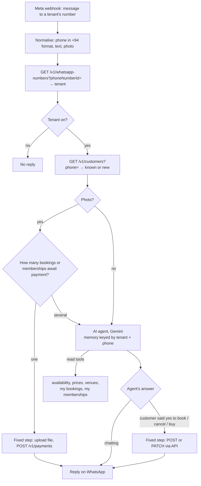

# The WhatsApp Assistant

The Assistant is an n8n workflow ([ADR 0006](../adr/0006-n8n-receives-chats.md)). It follows the GenexoAI WhatsApp bot design: a channel-neutral core, read-only AI tools, and fixed steps for anything that changes data. Stories: `AST-*`.

## Flow



## Rules

- **The AI only reads.** Its tools call `GET` routes. Creating a booking, cancelling or buying a membership happens in a fixed n8n step, only after the agent returns a structured "customer confirmed" answer that names the exact resource, start time and price.
- **Every API call** sends the assistant key plus `X-Tenant-Id` and `X-Customer-Phone` ([tenancy.md](tenancy.md)). The API applies the same rules as the portal. The Assistant gets no extra powers.
- **Chat memory** uses n8n's Postgres chat memory in the **n8n database**, keyed by `tenantId:phone`. It resets after 30 minutes of silence. n8n never connects to the app database.
- **AI model:** Gemini, set in n8n credentials. Changing the model is an n8n change only.
- **Language:** the agent replies in the customer's language. The prompt says to answer only from tool results.
- **Unknown or stuck:** the reply includes the venue's phone number (`AST-06`). One active venue: its name and phone in one sentence. Several: a list of each with its phone.
- **Only Meta gets in.** Every delivery must carry Meta's `X-Hub-Signature-256`, an HMAC of the body made with the app secret. Anything else gets 401 and is dropped, so nobody can pretend to be a customer. The `GET` on the same address answers Meta's one-time verify check.
- **Answer Meta first.** The workflow replies 200 as soon as the signature checks out, then does the work and sends the answer as a separate request to Meta. Meta resends a message it thinks went unanswered, so a slow answer must never hold up the 200.
- **New number (`AST-05`):** a phone with no customer record at the tenant is asked its name. The next message within 30 minutes is taken as the name ("Hi, I'm Kamal" saves "Kamal"; a bare greeting is asked again) and saved with `POST /v1/customers`. When it last asked is kept in `assistant_name_asks` in the n8n database.
- **No reply** when the business number is unknown or its tenant is off, and for Meta's delivery and read receipts.

## Messages the backend sends

Confirmations, rejections, cancellations, reminders, login codes and staff invites are sent by the API through `MessagingChannel`, not by n8n. Messages about TurfTap itself come from the shared TurfTap number: login codes, staff invites (`SIG-03`) and the first Owner's welcome (`PLA-01`), since a new tenant has no number yet. Messages about a booking or membership come from the tenant's number.

Messages to a customer go through `notifyCustomer()` in the `notifications` module, called inside the transaction that saves the change. It queues a job, so nothing is sent if that change rolls back. When the job runs it sends a template from the tenant's number to the customer's current phone. A tenant that is off sends nothing. A tenant with no number linked sends nothing and a warning is logged with its tenant id (D-04).

WhatsApp only allows free-form messages within 24 hours of the customer's last message. Outside that window, Meta requires **pre-approved message templates**. Every backend-sent message therefore has a template, registered with Meta per number; the template names are listed in `WHATSAPP_TEMPLATES` in `apps/api/src/ports/messaging-channel.ts`.

## Where the workflow lives

The workflow is exported as JSON to `n8n/workflows/assistant.json` and committed, with its manual test checklist beside it (`assistant.checklist.md`, D-17). Changes made in the n8n editor are exported with `bun run assistant:export` and committed in the same pull request as any API change they need. Credentials are never exported.

## Settings

Secrets live in n8n, never in the export. HTTP steps use n8n **credentials**; Code steps can't read credentials, so the two values they check come from the n8n container's environment (`N8N_BLOCK_ENV_ACCESS_IN_NODE=false`).

| Name | Kind | What |
|---|---|---|
| `TurfTap API (Assistant key)` | Header credential | `Authorization: Assistant <ASSISTANT_API_KEY>` |
| `WhatsApp Cloud API` | Header credential | `Authorization: Bearer <Meta access token>` |
| `n8n database` | Postgres credential | n8n's own database, for its tables in [`n8n/schema.sql`](../../n8n/schema.sql) and, from T36, chat memory |
| `TURFTAP_API_URL` | Environment | Where the API is |
| `WHATSAPP_GRAPH_URL` | Environment | Meta's Graph API with its version, like `https://graph.facebook.com/v23.0` |
| `WHATSAPP_APP_SECRET` | Environment | Checks Meta's signature |
| `WHATSAPP_VERIFY_TOKEN` | Environment | Answers Meta's verify check |

The Code steps also need `NODE_FUNCTION_ALLOW_BUILTIN=crypto` for the signature check.

## Running it locally

There's no Meta locally, so a second workflow, **pretend Meta** ([`n8n/workflows/fake-meta.json`](../../n8n/workflows/fake-meta.json)), stands in for Meta's send address: `WHATSAPP_GRAPH_URL` points at it, it keeps every message the Assistant sends in `fake_meta_messages` and hands them back from `POST /webhook/fake-meta/inbox`. The Assistant itself runs exactly as it will live; only that address changes.

```bash
bun run assistant:setup   # n8n tables, credentials made from .env, both workflows; run again after pulling changes
bun run emulator          # WhatsApp-style chat on http://localhost:5175
```

The **chat emulator** ([`tools/chat-emulator`](../../tools/chat-emulator), adapted from GenexoAI's) sends each message the way Meta does, signed with the app secret from `.env`, to the business number picked in its settings, and shows the answers from pretend Meta's inbox. It's a testing tool, so the portal and console rules don't apply to it.

n8n runs in Docker and reaches the API on your computer at `host.docker.internal`. If your computer runs the `ufw` firewall, let Docker's networks through to the API once: `sudo ufw allow in from 172.16.0.0/12 to any port 3000 proto tcp`.
