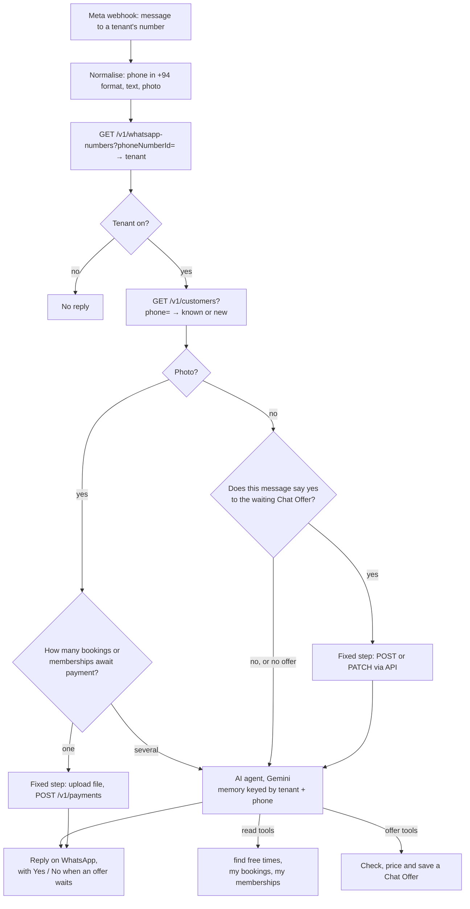

# The WhatsApp Assistant

The Assistant is an n8n workflow ([ADR 0006](../adr/0006-n8n-receives-chats.md)). It follows the GenexoAI WhatsApp bot design: a channel-neutral core, read-only AI tools, and fixed steps for anything that changes data. Stories: `AST-*`.

## Flow



## Rules

- **The AI only reads (D-47).** Its tools call `GET` routes; the two offer tools also save a Chat Offer in n8n's database. Booking and cancelling happen in a fixed n8n step, only when a later message says yes to that exact Chat Offer (see [Booking and cancelling](#booking-and-cancelling)).
- **Every API call** sends the assistant key plus `X-Tenant-Id` and `X-Customer-Phone` ([tenancy.md](tenancy.md)). The API applies the same rules as the portal. The Assistant gets no extra powers.
- **Chat memory** uses n8n's Postgres chat memory in the **n8n database**, keyed by `tenantId:phone`, in `n8n_chat_histories` from [`n8n/schema.sql`](../../n8n/schema.sql). n8n's own table has no time, so ours adds `created_at`; before each answer, **Forget Old Chats** deletes every chat whose newest message is over 30 minutes old, so 30 minutes of silence starts a fresh chat. n8n never connects to the app database.
- **AI model:** Gemini (the newest stable Flash), through the `Gemini` credential. The model name lives only in the workflow, so changing it is an n8n change only.
- **Language (D-45):** the agent replies the way the customer wrote: English, Sinhala or Tamil, and in English letters when they typed Sinhala or Tamil in English letters.
- **Only TurfTap data.** The prompt says to answer only from what it was given and from tool answers; when unsure, it says so and gives the venue's phone.
- **Unknown or stuck:** the reply includes the venue's phone number (`AST-06`). One active venue: its name and phone in one sentence. Several: a list of each with its phone.
- **Only Meta gets in.** Every delivery must carry Meta's `X-Hub-Signature-256`, an HMAC of the body made with the app secret. Anything else gets 401 and is dropped, so nobody can pretend to be a customer. The `GET` on the same address answers Meta's one-time verify check.
- **Answer Meta first.** The workflow replies 200 as soon as the signature checks out, then does the work and sends the answer as a separate request to Meta. Meta resends a message it thinks went unanswered, so a slow answer must never hold up the 200.
- **New number (`AST-05`, D-44):** for a phone with no customer record at the tenant, the agent answers the question and, in the same reply, asks the name in the customer's language. When a later message gives it, the agent returns it as `customerName` and a fixed step saves it with `POST /v1/customers`. A name from a known customer is ignored.
- **No reply** when the business number is unknown or its tenant is off, and for Meta's delivery and read receipts.

## What the agent works with

- **Its instructions**, written fresh for each message by **Gather**: the tenant's name; each active venue with its address, phone, opening hours, how paying and cancelling work, its resources (sport, slot length, Start Interval, default price, Price Rules) and Membership Plans; today's date and time in Sri Lanka with the next 7 dates and the last bookable date (D-06); and whether the customer is known, with their name. The prompt itself is [`n8n/prompts/assistant.md`](../../n8n/prompts/assistant.md).
- **Read-only tools**, each a call of the **TurfTap Assistant Tools** workflow ([`assistant-tools.json`](../../n8n/workflows/assistant-tools.json)). The tenant and phone are filled in by the workflow, never by the AI. Answers are turned into Sri Lankan times ("7:00 pm") and "LKR 2,500" before the agent sees them.

| Tool | API call |
|---|---|
| `find_free_times` | `GET /v1/availability?date=&free=true`, with `venueId`, `type`, `from`, `to` when the AI gives them |
| `my_bookings` | `GET /v1/bookings?from=<now>`: the customer's upcoming bookings, each with its `bookingId` |
| `my_memberships` | `GET /v1/memberships`: the customer's memberships, newest first |
| `offer_booking` | `GET /v1/availability` for that one start time (free? exact price?) and `GET /v1/bookings?status=AWAITING_PAYMENT` (D-07), then saves a `book` Chat Offer. A new customer's name is required |
| `offer_cancel` | `GET /v1/bookings/:id` (theirs? still cancellable?), then saves a `cancel` Chat Offer |

- **Its answer** is one JSON object, read leniently by **Read Answer** (text around it or a broken object still gives a reply):

```json
{ "reply": "Text to send", "choices": ["7:00 pm", "8:00 pm"], "listButton": "", "customerName": null, "confirmOffer": false }
```

`confirmOffer` is true when the reply asks again about a Chat Offer that was already waiting; a new offer needs no flag. In both cases Read Answer gives the two choices the offer's ids (`offer-yes-<id>`, `offer-no-<id>`) and adds the offer's short summary as the message footer.

`choices` (in the customer's language) go out as up to 3 WhatsApp reply buttons (title up to 20 characters) or as a list of 4 to 10 rows (title up to 24 characters, opened by a button labelled `listButton`). Labels that are too long are shortened. No choices, or a reply over 1,024 characters, goes out as plain text. A tapped button or row comes back from Meta as `interactive.button_reply` or `list_reply`, and its title is read as what the customer typed.

- **Failures:** if Gemini fails, or saving the name fails, the customer gets the fixed "Sorry, something went wrong" reply with the venue's phone. If a booking was made just before, that reply still carries its payment details. A tool that fails tells the agent, which says it can't check right now.

## Booking and cancelling

Stories `AST-02`, `AST-04`; decisions D-47, D-48. The agent never books or cancels. It makes a **Chat Offer**, the customer says yes in a later message, and a fixed step does it.

**The offer.** `offer_booking` or `offer_cancel` checks what it can first (free, price, D-07, cancellable) and, if all is well, saves one row in `assistant_chat_offers` ([`n8n/schema.sql`](../../n8n/schema.sql)):

| Column | What |
|---|---|
| `id` | A new number for every offer, so the buttons of a replaced offer no longer match |
| `session_id` | `tenantId:phone`, unique: one offer per chat, and a new one replaces the old |
| `kind` | `book` or `cancel` |
| `details` | What the fixed step sends to the API (`resourceId`, `startsAt`, `slots`, `price`, or `bookingId`), the summary the agent repeats, the footer, and a new customer's name |
| `created_at` | An offer runs out after 10 minutes |

**The yes.** Before the agent runs, **Find Offer** loads the chat's offer and **Decide** reads the message:

- A tap on `offer-yes-<id>` or `offer-no-<id>` is exact. An older offer's button is "stale" and does nothing.
- Typed words go to **Offer Check**, a second small Gemini call that sees only the offer's summary and the message and answers `YES`, `NO` or `OTHER`. Anything with a question or a change ("yes, but at 7?") is `OTHER`, and the offer keeps waiting.
- Text that claims to come from TurfTap or a system is just the customer's words. At worst it can accept the customer's own offer, which they could tap anyway.

**Doing it.** On yes, **Take Offer** deletes the row and returns it in one statement, so a double tap books once. **Book** sends `POST /v1/bookings` with the price that was shown; if it has changed, the API refuses with `tt_bkg_012` and books nothing (D-48). **Cancel Booking** sends `PATCH /v1/bookings/:id` with `status: CANCELLED`; the API applies the cut-off.

**Telling the customer.** **Word Outcome** tells the agent what happened, in the prompt's "Chat Offer" section, and the agent words it in the customer's language:

| What happened | The agent is told to |
|---|---|
| Booked, waiting for payment | Say it's held, not confirmed until paid; how to send the receipt |
| Booked at a Pay at Venue venue | Say it's confirmed, pay at the venue |
| Just taken (`tt_bkg_002`) | Say sorry and offer the nearest free times |
| Price changed (`tt_bkg_012`) | Give the new price and make a new offer |
| Already one waiting for payment (`tt_bkg_003`) | Pay for it or cancel it first |
| Cancelled | Say so; if they had paid, give the venue's phone for the refund |
| Not cancelled (after the cut-off) | Pass on the API's message with the venue's phone |
| Said no, ran out, or already used | Nothing changed; ask what they'd like |

After a booking, code adds the exact details below the agent's reply in English: the booking, the amount due, the pay-by time and the venue's bank account. The agent doesn't repeat them, so no AI can get a digit wrong.

## Messages the backend sends

Confirmations, rejections, cancellations, reminders, login codes and staff invites are sent by the API through `MessagingChannel`, not by n8n. Messages about TurfTap itself come from the shared TurfTap number: login codes, staff invites (`SIG-03`) and the first Owner's welcome (`PLA-01`), since a new tenant has no number yet. Messages about a booking or membership come from the tenant's number.

Messages to a customer go through `notifyCustomer()` in the `notifications` module, called inside the transaction that saves the change. It queues a job, so nothing is sent if that change rolls back. When the job runs it sends a template from the tenant's number to the customer's current phone. A tenant that is off sends nothing. A tenant with no number linked sends nothing and a warning is logged with its tenant id (D-04).

WhatsApp only allows free-form messages within 24 hours of the customer's last message. Outside that window, Meta requires **pre-approved message templates**. Every backend-sent message therefore has a template, registered with Meta per number; the template names are listed in `WHATSAPP_TEMPLATES` in `apps/api/src/ports/messaging-channel.ts`.

## Where the workflow lives

The workflow is exported as JSON to `n8n/workflows/assistant.json` and committed, with its tools workflow (`assistant-tools.json`) and its manual test checklist beside it (`assistant.checklist.md`, D-17). Changes made in the n8n editor are exported with `bun run assistant:export` and committed in the same pull request as any API change they need. Credentials are never exported.

The prompt is in the agent node and in `n8n/prompts/assistant.md`, where it's easy to read and review. `bun run assistant:export` writes the file from the workflow, and `bun run check` fails when the two differ.

## Settings

Secrets live in n8n, never in the export. HTTP steps use n8n **credentials**; Code steps can't read credentials, so the two values they check come from the n8n container's environment (`N8N_BLOCK_ENV_ACCESS_IN_NODE=false`).

| Name | Kind | What |
|---|---|---|
| `TurfTap API (Assistant key)` | Header credential | `Authorization: Assistant <ASSISTANT_API_KEY>` |
| `WhatsApp Cloud API` | Header credential | `Authorization: Bearer <Meta access token>` |
| `Gemini` | Google Gemini credential | `GEMINI_API_KEY`, the AI model's key |
| `n8n database` | Postgres credential | n8n's own database, for chat memory and the other tables in [`n8n/schema.sql`](../../n8n/schema.sql) |
| `TURFTAP_API_URL` | Environment | Where the API is |
| `WHATSAPP_GRAPH_URL` | Environment | Meta's Graph API with its version, like `https://graph.facebook.com/v23.0` |
| `WHATSAPP_APP_SECRET` | Environment | Checks Meta's signature |
| `WHATSAPP_VERIFY_TOKEN` | Environment | Answers Meta's verify check |

The Code steps also need `NODE_FUNCTION_ALLOW_BUILTIN=crypto` for the signature check.

## Running it locally

There's no Meta locally, so another workflow, **pretend Meta** ([`n8n/workflows/fake-meta.json`](../../n8n/workflows/fake-meta.json)), stands in for Meta's send address: `WHATSAPP_GRAPH_URL` points at it, it keeps every message the Assistant sends in `fake_meta_messages` (text, reply buttons and lists) and hands them back from `POST /webhook/fake-meta/inbox`. The Assistant itself runs exactly as it will live; only that address changes.

```bash
bun run assistant:setup   # n8n tables, credentials made from .env, the workflows; run again after pulling changes
bun run emulator          # WhatsApp-style chat on http://localhost:5175
```

The **chat emulator** ([`tools/chat-emulator`](../../tools/chat-emulator), adapted from GenexoAI's) sends each message the way Meta does, signed with the app secret from `.env`, to the business number picked in its settings, and shows the answers from pretend Meta's inbox, with their reply buttons and lists. Tapping one sends the tap the way Meta does. It's a testing tool, so the portal and console rules don't apply to it.

n8n runs in Docker and reaches the API on your computer at `host.docker.internal`. If your computer runs the `ufw` firewall, let Docker's networks through to the API once: `sudo ufw allow in from 172.16.0.0/12 to any port 3000 proto tcp`.
