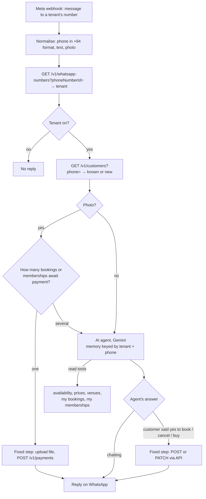

# The WhatsApp Assistant

The Assistant is an n8n workflow ([ADR 0006](../adr/0006-n8n-receives-chats.md)). It follows the GenexoAI WhatsApp bot design: a channel-neutral core, read-only AI tools, and fixed steps for anything that changes data. Stories: `AST-*`.

## Flow

## Rules

- **The AI only reads.** Its tools call `GET` routes. Creating a booking, cancelling or buying a membership happens in a fixed n8n step, only after the agent returns a structured "customer confirmed" answer that names the exact resource, start time and price.
- **Every API call** sends the assistant key plus `X-Tenant-Id` and `X-Customer-Phone` ([tenancy.md](tenancy.md)). The API applies the same rules as the portal. The Assistant gets no extra powers.
- **Chat memory** uses n8n's Postgres chat memory in the **n8n database**, keyed by `tenantId:phone`. It resets after 30 minutes of silence. n8n never connects to the app database.
- **AI model:** Gemini, set in n8n credentials. Changing the model is an n8n change only.
- **Language:** the agent replies in the customer's language. The prompt says to answer only from tool results.
- **Unknown or stuck:** the reply includes the venue's phone number (`AST-06`).

## Messages the backend sends

Confirmations, rejections, cancellations, reminders and login codes are sent by the API through `MessagingChannel`, not by n8n. Login codes come from the shared TurfTap number. Everything else comes from the tenant's number.

WhatsApp only allows free-form messages within 24 hours of the customer's last message. Outside that window, Meta requires **pre-approved message templates**. Every backend-sent message therefore has a template, registered with Meta per number; the template names are listed in `apps/api/src/modules/notifications/templates.ts`.

## Where the workflow lives

The workflow is exported as JSON to `n8n/workflows/` and committed. Changes made in the n8n editor are exported and committed in the same pull request as any API change they need. Credentials are never exported.
