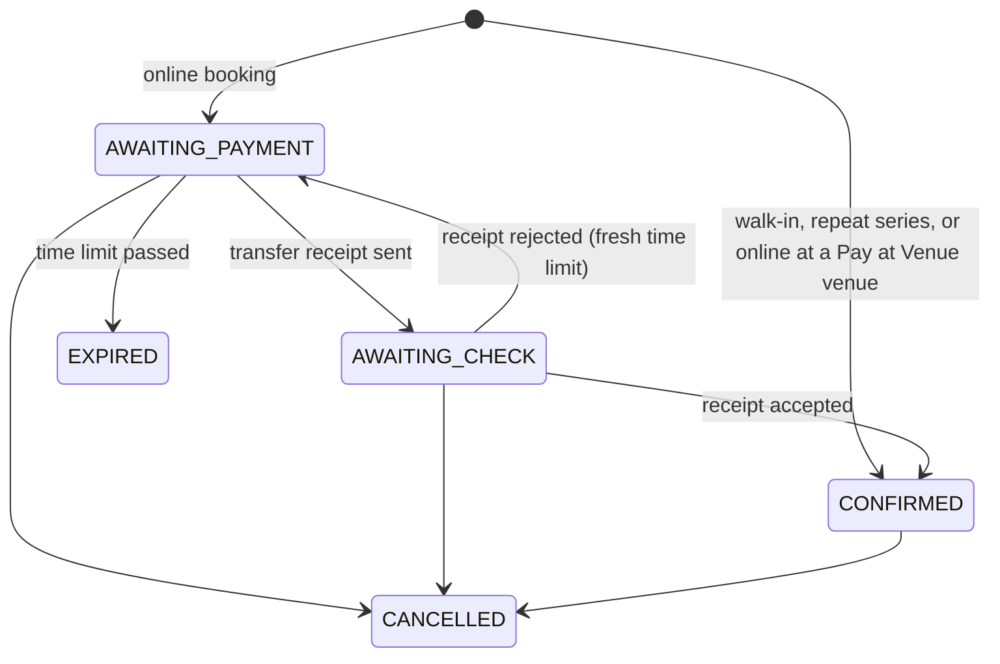
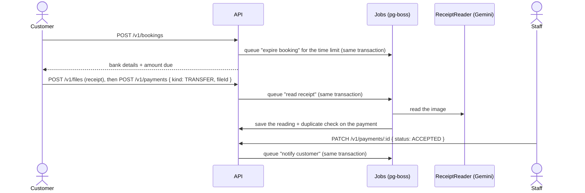

# Bookings, payments and receipt checks

How money and slot holds work in v1 ([ADR 0007](../adr/0007-bank-transfer-with-ai-check.md)). Stories: `BKG-*`, `PAY-*`, `MEM-*`.

## Booking states



Memberships use the same states, with `ACTIVE` in place of `CONFIRMED`. As with bookings, `EXPIRED` means not paid in time. Memberships also have `ENDED` once their end date passes.

**Holding slots:** `AWAITING_PAYMENT`, `AWAITING_CHECK` and `CONFIRMED` hold their slots. Postgres itself refuses two holding bookings that overlap on one resource:

```sql
ALTER TABLE bookings ADD CONSTRAINT bookings_no_overlap
  EXCLUDE USING gist (resource_id WITH =, tstzrange(starts_at, ends_at) WITH &&)
  WHERE (status IN ('AWAITING_PAYMENT', 'AWAITING_CHECK', 'CONFIRMED'));
```

Blocked times and closed dates are checked by the service when booking, and the booking itself refuses to overlap them.

## Payments

A booking or membership has a list of **payments**. Each payment has a `kind` and an `amount` in cents:

| Kind | Made by | Status |
|---|---|---|
| `TRANSFER` | Customer, with a transfer receipt file | `PENDING_CHECK` → `ACCEPTED` or `REJECTED` |
| `CASH` | Front Desk | `ACCEPTED` straight away |
| `REFUND` | Manager, as a record only (negative amount) | `ACCEPTED` straight away |

Each booking shows **paid** (its `ACCEPTED` payments added up, refunds included) and **balance** (the price less what was paid, or zero once the booking no longer holds its slots).

- Rules that compare with what was paid (cash up to the balance, refunds up to what was paid) lock the booking first with `bookingsService.get(auth, id, "update")`, so two payments saved together can't both fit.
- Each payment keeps its booking's `venueId`, so staff limited to some venues are filtered in the SQL, the same way as bookings.
- A walk-in paid in cash (`BKG-04`) gets its `CASH` payment for the full price in the same transaction that saves the booking. Staff send `walkIn` in `POST /v1/bookings`; customers and the Assistant never do.
- Refunds are for Owners and Managers only. Front Desk holds `payments:create` for cash, so the service refuses their refunds with 403 (`tt_pay_007`).

A **Receipt Check** is staff PATCHing a `TRANSFER` payment to `ACCEPTED` or `REJECTED` (`rejectReason` required). In the same transaction, the service moves the booking forward or back.

## Flow



- **Amount due now** = the full price, or the venue's advance percentage rounded up to whole rupees. It's fixed when the booking is created. At a Pay at Venue venue nothing is due online.
- **One unpaid booking:** a customer has at most one `AWAITING_PAYMENT` booking per tenant, enforced by a partial unique index.
- **Venue settings are copied onto the booking** when it's made: the amount due, the expiry time (now + the venue's Payment Time Limit) and the Cancellation Cut-off. Changing a venue's settings later affects new bookings only (`VEN-03`).
- **Duplicates:** each receipt stores its image hash and the reference number the AI read. A match on either one, inside the same tenant, shows a warning (`PAY-06`). It's a warning, not a block: staff decide.
- **AI reading** never changes a status. It only fills `receiptReading` (amount, date, bank, reference, plus "matches" flags) for staff to see.
- **Jobs are queued inside the same transaction** as the data, so a job can never run for a booking that didn't save.
- The expiry job uses a conditional UPDATE (`WHERE status = 'AWAITING_PAYMENT'`), so a receipt arriving at the last second wins cleanly.

## Scheduled jobs

| Job | When | Does |
|---|---|---|
| Expire booking | At the time limit | `AWAITING_PAYMENT` → `EXPIRED`, notify |
| Booking reminder | 3 hours before start | WhatsApp reminder |
| End memberships | Daily, 00:05 Colombo time | `ACTIVE` past end date → `ENDED` |
| Ask for series payment | The venue's series payment days before each repeat series booking | WhatsApp with bank details and the Advance |
| Membership reminder | Daily | WhatsApp 3 days before end |

Each job checks the row's current state when it runs and does nothing if things have moved on.
