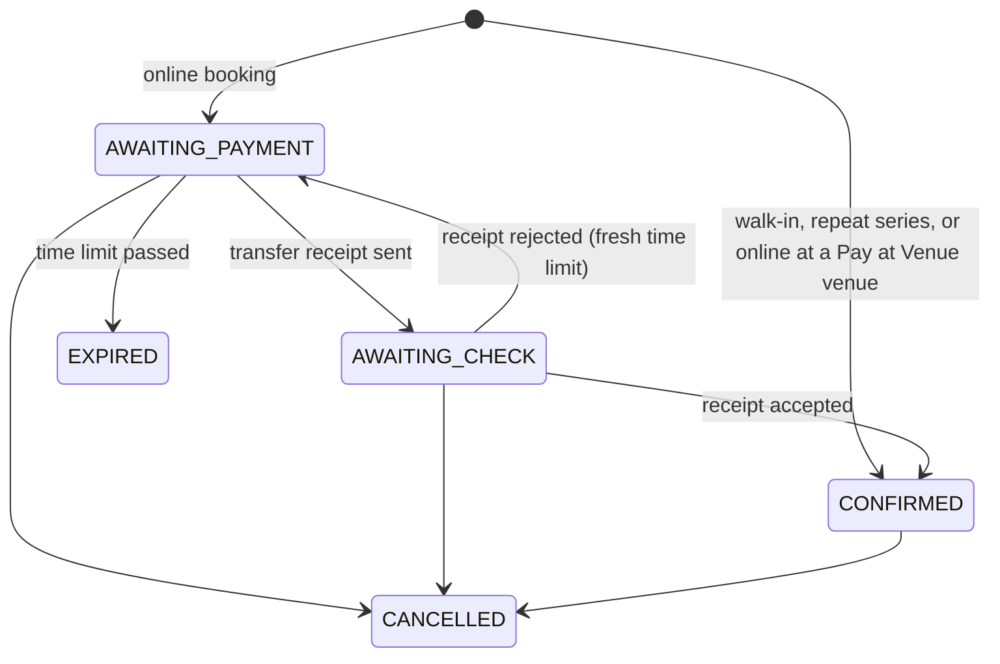
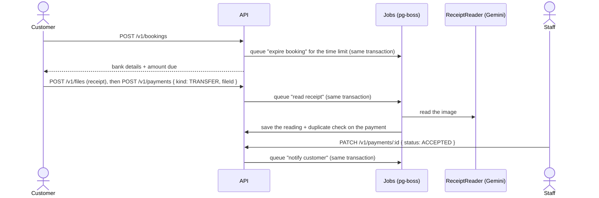

# Bookings, payments and receipt checks

How money and slot holds work in v1 ([ADR 0007](../adr/0007-bank-transfer-with-ai-check.md)). Stories: `BKG-*`, `PAY-*`, `MEM-*`.

## Booking states



Memberships use the same states, with `ACTIVE` in place of `CONFIRMED`. As with bookings, `EXPIRED` means not paid in time. Memberships also have `ENDED` once their end date passes.

**Holding slots:** `AWAITING_PAYMENT`, `AWAITING_CHECK` and `CONFIRMED` hold their slots. Postgres itself refuses two holding bookings that overlap on one resource:

```sql
ALTER TABLE bookings ADD CONSTRAINT bookings_no_overlap
  EXCLUDE USING gist (resource_id WITH =, tstzrange(starts_at, ends_at) WITH &&)
  WHERE (status IN ('AWAITING_PAYMENT', 'AWAITING_CHECK', 'CONFIRMED'));
```

Blocked times and closed dates are checked by the service when booking, and the booking itself refuses to overlap them.

## Payments

A booking or membership has a list of **payments**. Each payment has a `kind` and an `amount` in cents:

| Kind | Made by | Status |
|---|---|---|
| `TRANSFER` | Customer, with a transfer receipt file | `PENDING_CHECK` → `ACCEPTED` or `REJECTED` |
| `CASH` | Front Desk | `ACCEPTED` straight away |
| `REFUND` | Manager, as a record only (negative amount) | `ACCEPTED` straight away |

Each booking shows **paid** (its `ACCEPTED` payments added up, refunds included) and **balance** (the price less what was paid, or zero once the booking no longer holds its slots).

- Rules that compare with what was paid (cash up to the balance, refunds up to what was paid) lock the booking first with `bookingsService.get(auth, id, "update")`, so two payments saved together can't both fit.
- Each payment keeps its booking's `venueId`, so staff limited to some venues are filtered in the SQL, the same way as bookings.
- A walk-in paid in cash (`BKG-04`) gets its `CASH` payment for the full price in the same transaction that saves the booking. Staff send `walkIn` in `POST /v1/bookings`; customers and the Assistant never do.
- A Repeat Series (`BKG-09`) creates all its bookings `CONFIRMED` in one transaction, with nothing due now, like a walk-in paid later. Each booking has the series' `repeatSeriesId`. The series keeps a copy of the venue's series payment days and Advance, for asking for each payment later (T47). Cancelling the series cancels its bookings that haven't started; the customer gets one `series_cancelled` message.
- Refunds are for Owners and Managers only. Front Desk holds `payments:create` for cash, so the service refuses their refunds with 403 (`tt_pay_007`).

**Sending a Transfer Receipt** (`PAY-02`) takes two calls: `POST /v1/files` with purpose `RECEIPT`, then `POST /v1/payments { kind: "TRANSFER", bookingId, fileId }` by the customer, the Assistant or staff.

- The payment is `PENDING_CHECK` for the booking's amount due. In the same transaction the booking moves `AWAITING_PAYMENT` → `AWAITING_CHECK`, with the booking locked from the checks to that change.
- A booking past its Payment Time Limit refuses the receipt (`tt_pay_009`), even if the expiry job hasn't run yet.
- Only whoever uploaded a receipt file may attach it (the customer and the Assistant acting for them count as one), and one file pays once. So nobody can reach someone else's receipt by guessing its id.
- The file row keeps the SHA-256 of the receipt's bytes for the reused-receipt check (`PAY-06`, D-13).
- Whoever may see the payment gets `receiptUrl`, a link that works for 15 minutes.

**Reading a Transfer Receipt** (`PAY-03`, `PAY-06`): sending the receipt also queues the `read-receipt` job in the same transaction. The job asks `ports().receiptReader` once and saves the Receipt Reading in its own table, `receipt_readings`, one row per payment. Payments show it as `receiptReading`, which is `null` until then.

- `amountMatches`: the amount read is exactly the payment's amount (the amount due). Paying the full price when only the Advance was due shows "doesn't match", so staff take a look.
- `dateRecent` (D-12): paid on or after the day the booking was made, and not after today, both in the venue's time zone.
- `referenceNew`: no earlier payment in the tenant was read with the same reference. References are saved in upper case without spaces or dashes, so `ft 0042` and `FT-0042` match.
- `duplicateOf`: the earliest earlier payment in the tenant, at any venue, with the same receipt image (`files.sha256`, D-13) or the same reference. It's a warning only.
- A reader that fails is the adapter's problem: the port never rejects, so it reads as `unreadable` and staff check by hand.
- All of it is worked out once, when the job runs, and then saved. Two different images of one transfer read at the very same moment can miss each other's reference; the same image is always caught, because its hash is saved at upload.

A **Receipt Check** (`PAY-04`, `PAY-05`) is staff PATCHing a `PENDING_CHECK` payment to `ACCEPTED` or `REJECTED` (`rejectReason` required). Any staff role may do it; customers and the Assistant can't. In the same transaction:

- Accepted: the booking moves `AWAITING_CHECK` → `CONFIRMED`, and the customer gets `booking_confirmed`.
- Rejected: the booking moves `AWAITING_CHECK` → `AWAITING_PAYMENT` with a fresh `expiresAt` (the venue's current Payment Time Limit) and a new expiry job. The customer gets `receipt_rejected` with the reason and the new time to pay by.
- Rejected while the customer already has another booking waiting for payment (D-07 allows one): the booking is cancelled instead, with the reason as its `cancelReason`, and the customer gets `booking_cancelled`.
- A booking cancelled before the check stays cancelled. Only the payment changes and no message is sent; an accepted transfer counts as paid, so it can be refunded.
- The payment's status change is one conditional UPDATE, so of two staff checking at once, the second gets 409 (`tt_sts_002`).
- The booking calls live in `bookingsService.receiptAccepted` and `receiptRejected`. Memberships (T23) will get their own pair, picked by what the payment points at.

## Flow



- **Amount due now** = the full price, or the venue's advance percentage rounded up to whole rupees. It's fixed when the booking is created. At a Pay at Venue venue nothing is due online.
- **One unpaid booking:** a customer has at most one `AWAITING_PAYMENT` booking per tenant, enforced by a partial unique index.
- **Venue settings are copied onto the booking** when it's made: the amount due, the expiry time (now + the venue's Payment Time Limit) and the Cancellation Cut-off. Changing a venue's settings later affects new bookings only (`VEN-03`).
- **Duplicates:** each receipt file stores its image hash, and its Receipt Reading the reference number the AI read. A match on either one, inside the same tenant, shows a warning (`PAY-06`). It's a warning, not a block: staff decide.
- **AI reading** never changes a status. It only fills `receiptReading` (amount, date, bank, reference, plus "matches" flags) for staff to see.
- **Jobs are queued inside the same transaction** as the data, so a job can never run for a booking that didn't save.
- The expiry job uses a conditional UPDATE (`WHERE status = 'AWAITING_PAYMENT' AND expires_at <= now()`), so a receipt arriving at the last second wins cleanly, and the old job of a booking reopened by a rejected receipt does nothing.

## Scheduled jobs

| Job | When | Does |
|---|---|---|
| Expire booking | At the time limit | `AWAITING_PAYMENT` past its `expiresAt` → `EXPIRED`, notify |
| Booking reminder | 3 hours before start | WhatsApp reminder |
| End memberships | Daily, 00:05 Colombo time | `ACTIVE` past end date → `ENDED` |
| Ask for series payment | The venue's series payment days before each repeat series booking | WhatsApp with bank details and the Advance |
| Membership reminder | Daily | WhatsApp 3 days before end |

Each job checks the row's current state when it runs and does nothing if things have moved on.
